# PLAYNEX - EVERY GAME. ONE DESTINATION.
A PS5-inspired game launcher for Windows. It finds the games you already have installed from every major store, puts them in one clean console-style interface, tracks your playtime, shows ratings and reviews, and can turn your PC into a screensaver showcase.
> Built with Electron. No account, no cloud, no tracking: everything stays on your PC.

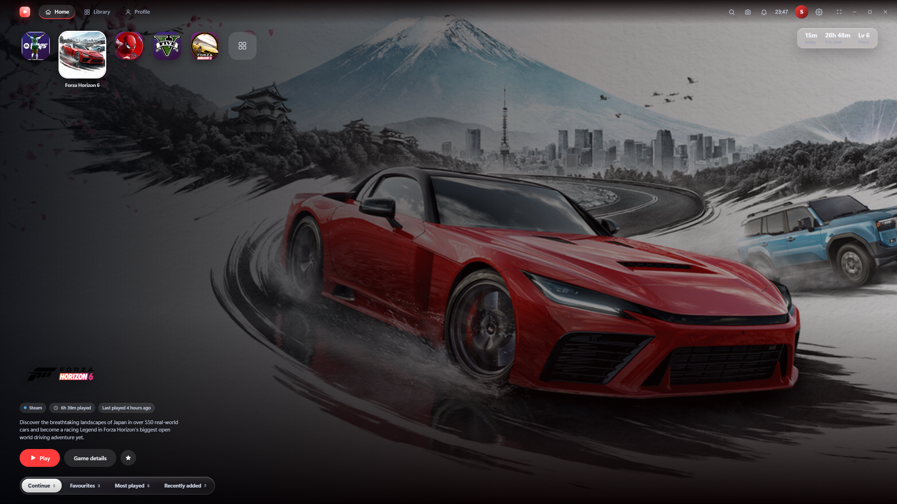

Screenshots use demo data and placeholder artwork. Ratings shown in previews are sample numbers, not real scores.

# **Features**
## **Library**

* **Automatic game detection** for Steam, Epic Games, Xbox / Game Pass, Ubisoft Connect, EA app, Battle.net, GOG, Riot Games and Rockstar, plus any folder you scan and any custom `.exe` you add.
* **Artwork and details** (covers, banners, descriptions, genres, developer, publisher, release date). Steam artwork is used automatically; add a free SteamGridDB key for better art for non-Steam games.
* **Favourites and collections**, search, sort and filters, and a toggle to hide games you don't want to see.
* Non-game tools and launchers are filtered out of the library.
  
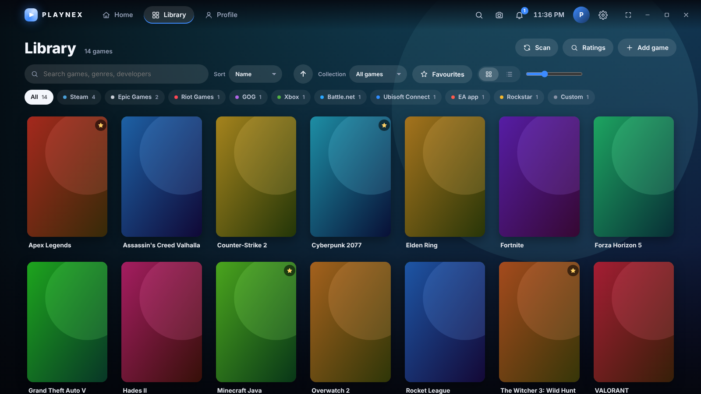

## ****Home and profile****

* Console-style Home with a big hero, a shelf of games and quick tabs: Continue, Favourites, Most played, Recently added, plus your own collections.
* Gaming profile with total playtime, sessions, streaks, charts, history, level and trophies.
* Playtime tracking that records each session while a game runs.
* Achievements: real Steam achievements (with your Steam Web API key and SteamID) and launcher trophies.

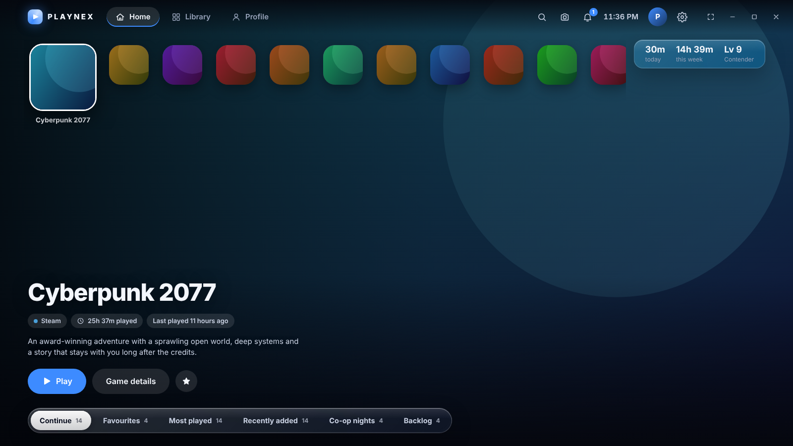

## Controller, keyboard and built-in Controller Test page
* Full gamepad navigation (D-pad / stick, A select, B back, LB/RB switch tabs, X favourite) and a built-in controller test page.
* Keyboard: `1/2/3/4` Home / Library / Profile / Settings, arrows to move, `Enter` open, `Esc` back, `F` favourite, `/` search, `F10` fullscreen, `F11` screenshot.

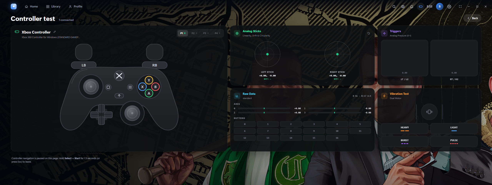

## **Ratings and reviews**
* Open a game's page for a Metacritic headline score and tiles for every platform (PC, PS5, Xbox and so on), with your platform highlighted.
* Critic and user reviews from Metacritic, Steam reviews, and RAWG, so you still get reviews without a Steam key.
* Ratings lookup: search any game by name, even ones you don't own.

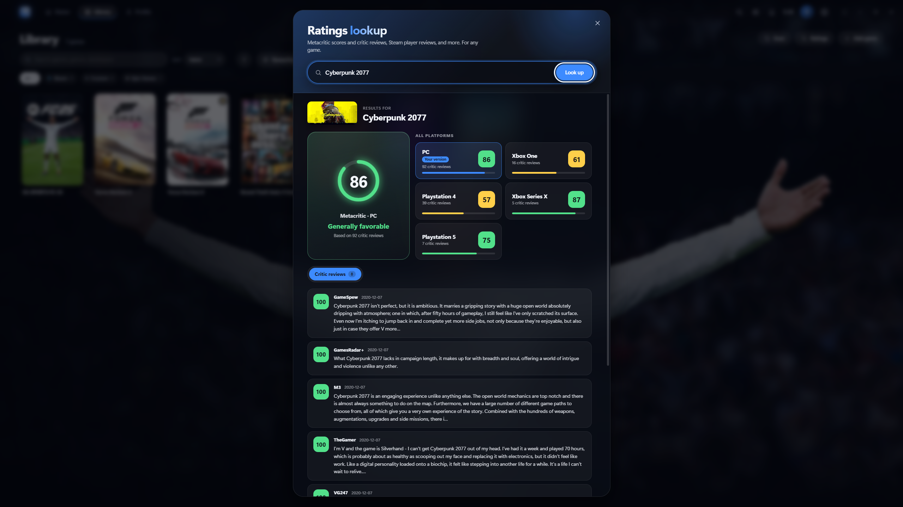

## **Screensaver**
* Idle screensaver with a configurable clock, date, size and position.
* Library showcase of your own game banners, with an optional now-playing music card.
* Online wallpapers from Wallhaven, Bing daily photos, WallpaperCave and Wallhalla: 16:9 only, at 2K or 4K, in the topics you pick (gaming, nature, animals; optionally space, cars, cities). Switch between online pictures, game banners, or a mix.
* Fetched one picture at a time while the screensaver plays. Nothing is downloaded in bulk.
* Keep downloaded pictures toggle: off deletes them the moment the launcher closes; on keeps up to 20, 40 or 80 so the screensaver works offline. At the limit, each new picture replaces the oldest.
* Open folder and Delete pictures buttons to manage the files yourself.

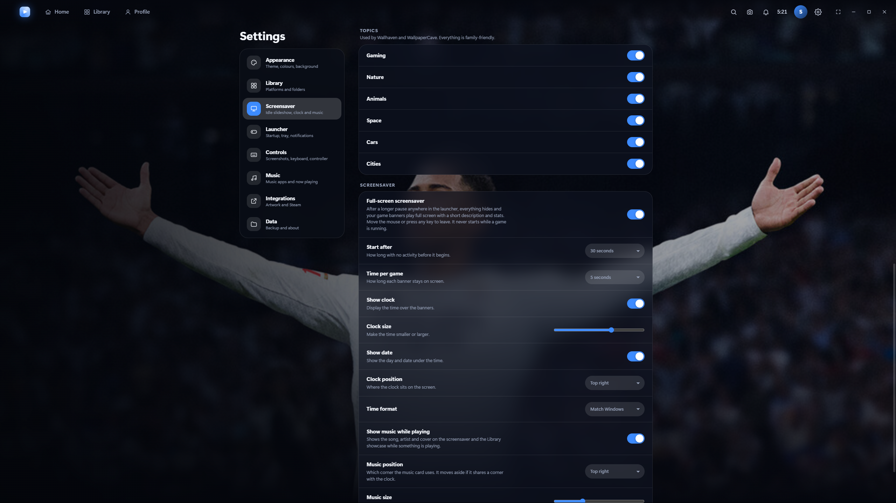

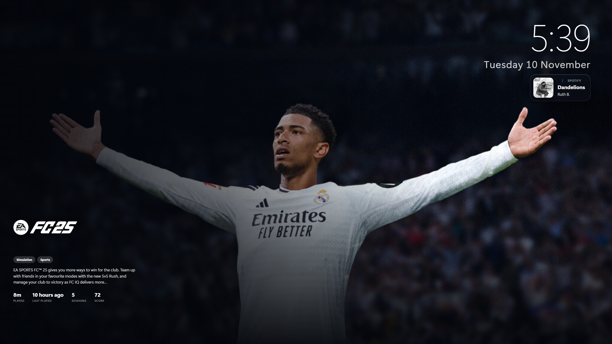
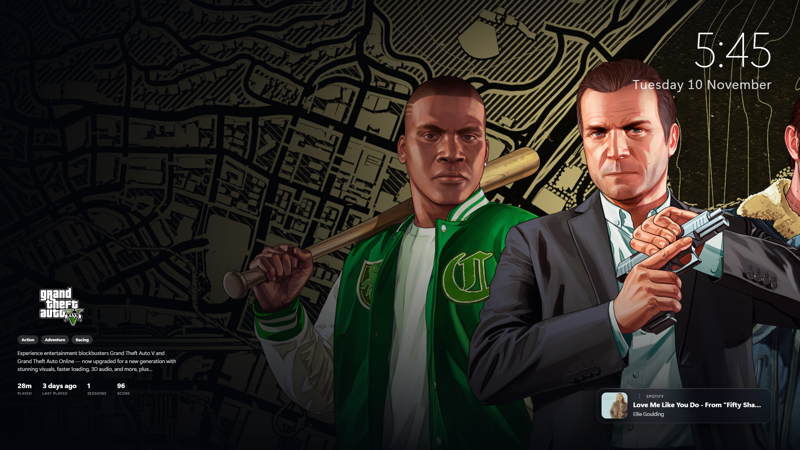

# **In-game overlay**
* Press `Ctrl+Shift+G` (changeable) for an overlay with CPU, RAM and GPU usage, over the game.
* Screenshot hotkey (`F11` by default), with a captures gallery.

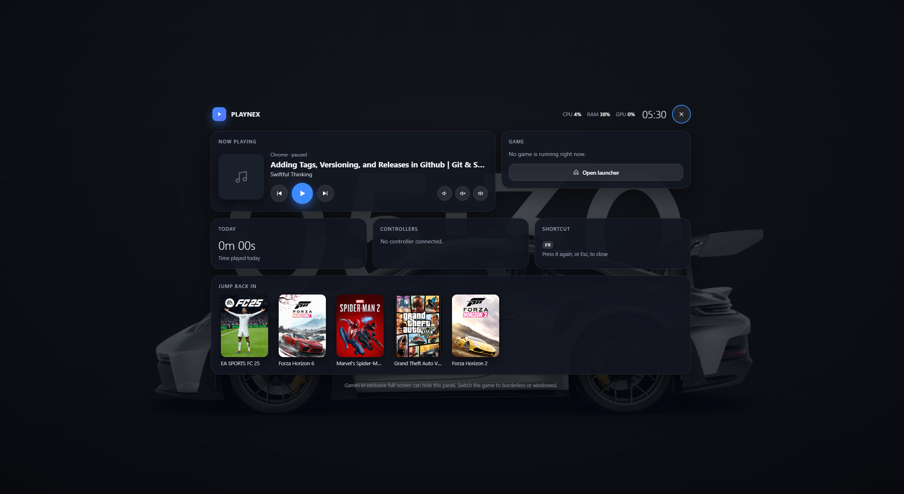

### Phone remote (Android)
- Pair your phone once, then see which game is running, **take a screenshot**, **control music**, **quit the game**, and **shut down or restart the PC**, from anywhere on your network or VPN.
- Off by default. One-time pairing code, a secret token per phone, and paired phones can be removed at any time.
- **Shut down / Restart** are also on the PC under Settings, Remote, with a 10-second cancel window.
- Setup and security details: [docs/REMOTE.md](docs/REMOTE.md).

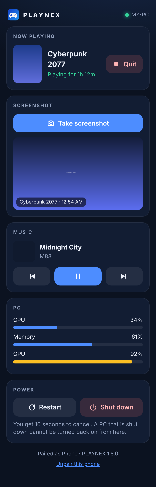 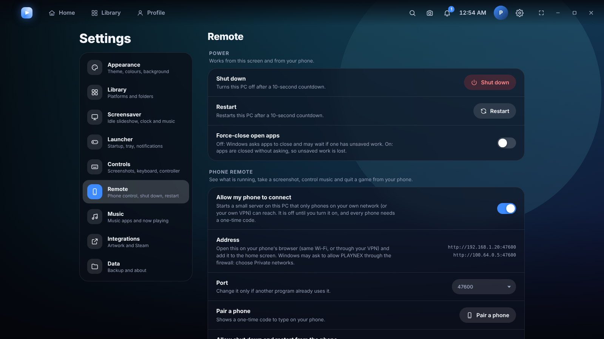

## Music
* Detects running music apps (Spotify and others) and shows now playing in the top bar and on the screensaver, with play / pause / skip controls.

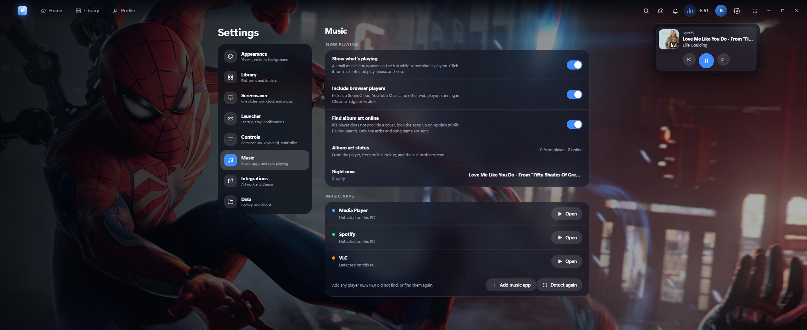

## Look and feel
* Dark, light or system theme, several colour themes, custom accent colour and background, glass effect.
* System tray, notifications, launch at startup, fullscreen "console" mode.
* Settings are organised into tabs: Appearance, Library, Screensaver, Launcher, Controls, Music, Integrations, Data (backup and export).

## Download
Grab the installer from the Releases page: `Game-Launcher-Setup-<version>.exe`. Windows 10 or 11, 64-bit.

# Build it yourself
* You need Node.js 18 or newer on Windows.
```bash
git clone https://github.com/<your-user>/<your-repo>.git
cd <your-repo>
npm install
npm start          # run the app
npm test           # unit tests + privacy check
npm run dist       # build the installer into dist/
```
* On Windows you can also double-click `build-windows.bat`: it checks the project, installs, builds, and checks the finished installer.
* No Windows PC? Run the Build Windows installer workflow on the Actions tab, or push a tag starting with `v` (for example `v1.6.4`), and download the installer from the run's artifacts.

## Optional keys (Settings, Integrations)
* Key	What it does
* SteamGridDB	Better artwork for non-Steam games
* Steam Web API key + SteamID	Real Steam achievements
* RAWG	Extra ratings and metadata
* Keys are stored only in your local settings file. They are never part of the code or the installer.

## Privacy
* No telemetry, no account, no analytics. The app only contacts the sites needed for artwork, ratings and wallpapers, and only when you use those features.
* The installer is built so it carries no details of the computer it was built on. `tools/privacy-check.js` scans the project before the build and the finished installer after it, looking for the builder's user name, computer name, home folder, user-profile paths, e-mail addresses, private IPs and MAC addresses. If anything is found the build stops and the installer is deleted. Run it any time with `npm run check:privacy`.
* Downloaded wallpapers live in the system temp folder and are deleted when the launcher closes, unless you turn on Keep downloaded pictures (then they sit in the app's data folder until you delete them).

## Project layout
```
main/        Electron main process: scanners, tracker, store, ratings, wallpapers, music, overlay
  scanners/  One detector per store (Steam, Epic, Xbox, Ubisoft, EA, Battle.net, GOG, Riot, Rockstar)
renderer/    The interface: views, styles, showcase (screensaver), overlay
tests/       Unit tests, plus UI preview scripts (need Playwright)
tools/       privacy-check.js
build/       App icons
.github/     Windows installer workflow
```
## Tests
`npm test` runs the parser, launch, ratings and wallpaper tests and the privacy check. UI previews (optional, need Playwright): `node tests/ui/screenshots.js ./shots`.

## Notes and disclaimers
* Game Launcher is an independent personal project. It is not affiliated with or endorsed by Sony, Microsoft, Valve, Epic Games, Metacritic, RAWG, or any store or wallpaper site mentioned here. All names and trademarks belong to their owners.
* Ratings, reviews, artwork and wallpapers come from third-party sites and stay the property of their owners. Wallpapers are fetched for personal viewing and are not redistributed by this project.
* Some sources have no official API and are read from their public pages, so they can change or stop working without notice. The app shows a clear message when a source can't be reached.
* The look is inspired by console dashboards; it contains no code or assets from any console.

## License
* MIT
